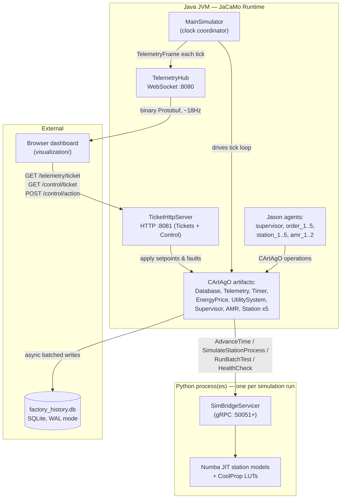

# Matrix Factory Twin — Developer Onboarding Guide

> **Purpose of this document.** A practical architectural map and engineering guide for developers working on the Matrix Factory Twin codebase. Physical/mathematical modeling inside the five manufacturing stations is covered separately in `docs/physical-engine/`. This guide focuses on the software architecture: agents, runtimes, protocols, synchronization, and the discrete-event simulation clock.

---

## 1. What this project actually is

**Matrix Factory Twin** is a discrete-event digital twin of a hydrogen fuel-cell (PEMFC) manufacturing line. Two runtimes cooperate over gRPC:

- A **Java multi-agent system** (JaCaMo: Jason BDI agents + CArtAgO shared-environment artifacts + Moise organizational specs) that models the *cognitive/logistics* layer — order dispatch, station negotiation, AMR transport, and two competing manufacturing-control philosophies (PROSA vs. ADACOR) that the system can switch between dynamically at runtime.
- A **Python physical engine** (Numba-JIT-compiled numerical models, CoolProp real-gas properties, a Cython extension) that models the *physical* layer — five manufacturing stations culminating in a PEMFC stack test bench.

The two are bridged by a **deterministic lock-stepped clock**: nothing in this simulation uses wall-clock time or `Thread.sleep` to pace itself. Every agent action that takes simulated time registers a "when do you next need to wake up" request, and a central coordinator (`MainSimulator.java`) advances the whole system — Java and Python together — to the earliest such request. Understand this mechanism (§5) before modifying agent or simulation code.

A live browser dashboard (`visualization/`) subscribes to binary telemetry over WebSocket and can inject station setpoints and AMR faults live over HTTP.

This codebase also backs an academic research manuscript: `report.tex`, `docs/artifact-evaluation/`, and `docs/citation.md` exist to support experiment replication and evaluation.

---

## 2. Glossary

| Term | Meaning in this codebase |
|---|---|
| **JaCaMo** | The Java framework gluing Jason, CArtAgO, and Moise together (`org.jacamo:jacamo`). |
| **Jason** | The BDI (Belief-Desire-Intention) agent language/runtime. Agent plans live in `.asl` files (`src/agt/`). |
| **CArtAgO** | The artifact-based environment model — shared, stateful objects agents observe and invoke (Java classes extending `cartago.Artifact` in `src/main/java/factory/`). |
| **Moise** | The organizational-model layer: roles, groups, and authority links, defined in `src/org/*.xml`. |
| **BDI** | Belief-Desire-Intention — the agent reasoning paradigm where agents hold beliefs (facts), pursue goals (`!goal`), and react to events (`+belief`). |
| **Holon** | An autonomous-but-cooperative manufacturing entity (e.g., order holon, resource holon). |
| **PROSA** | Product-Resource-Order-Staff Architecture — flat, heterarchical peer negotiation (§9). |
| **ADACOR** | Adaptive Holonic Control Architecture — hierarchical supervisor-directed control (§9). |
| **CNP** | Contract-Net Protocol — the bidding process order holons use to allocate work to resource holons (§7). |
| **2PC** | Two-Phase Commit — the protocol used to switch PROSA ⇄ ADACOR without losing in-flight work (§9). |
| **NER / TMC** | Next-Event-Request / Time-Managed-Component — the discrete-event clock coordination mechanism (§5). |
| **PEMFC** | Proton-Exchange-Membrane Fuel Cell — the product manufactured across the 5 stations. |
| **MEA / GDL / ECSA** | Membrane-Electrode Assembly / Gas-Diffusion Layer / Electrochemically-Active Surface Area — physical quality metrics passed across stations on the wire protocol. |

---

## 3. Repository map

```
Matrix_Factory/
├── src/
│   ├── agt/                     Jason agent behavior (.asl) — cognitive layer
│   │   ├── supervisor_agent.asl     Central coordinator, 2PC, defect monitoring
│   │   ├── order_holon.asl          Represents one production batch; runs CNP as initiator
│   │   ├── resource_holon.asl       Represents one station (S1–S5); runs CNP as responder
│   │   └── amr_agent.asl            Thin cognitive wrapper around AMRArtifact transport
│   ├── org/                     Moise organizational specs (roles + authority links)
│   │   ├── prosa_org.xml            Flat peer-negotiation topology
│   │   └── adacor_org.xml           Supervisor-authority hierarchy
│   ├── main/java/factory/       CArtAgO artifacts + simulation infrastructure (§6, §12–14)
│   ├── main/proto/sim_bridge.proto  Canonical gRPC/wire contract (§12)
│   ├── main/resources/          logback config, energy price-series CSVs
│   └── test/java/factory/       JUnit integration and seed-replay test suite (§16)
├── physical_engine/             Python physics engine
│   ├── sim_bridge_server.py         gRPC server implementing SimBridge RPCs
│   ├── daemon_launcher.py           Spawns/pins/supervises N daemons for batch runs
│   ├── proto_index.py               Python mirror of ProtoIndex.java (§12)
│   ├── core/                        Shared base types (Component, enums, constants)
│   ├── factory_simulation/          Five stations' physics implementations and pytest suites
│   ├── optimization/                Numba/Cython acceleration + LUT caching
│   ├── protos/                      Python proto copy + generated pb2 stubs
│   └── scripts/                     LUT prebuilding, calibration utilities
├── scripts/                     Operational tooling (§15)
│   ├── check_proto_sync.py          Validates that all .proto copies stay identical
│   ├── generate_certs.sh            Self-signed CA/server/client cert generation for mTLS
│   ├── generate_factory_jcm.py      Builds merged, namespaced Phase-4 mega-JCM files
│   ├── render_factory_jcm.py        Renders single-run factory.jcm from template
│   └── launch_phase4.sh             Orchestrates full Phase-4 batch runs end-to-end
├── experiments/                 PROSA-vs-ADACOR Monte Carlo driver + statistical analysis
├── analysis/                    Experiment results (CSVs, notebooks, reports)
├── visualization/               Standalone vanilla-JS + Canvas dashboard
├── docs/                        Complete mkdocs-material documentation site
├── factory.jcm / template       JaCaMo project definition for single simulation runs
├── build.gradle, settings.gradle Java build (Gradle 8.7+, Java 17 toolchain)
├── requirements.txt, setup.py   Python dependencies + Cython extension build
└── run_manual.sh                Automated JVM launch shortcut with build verification
```

---

## 4. High-level architecture



### Key Architectural Tenets:

1. **One Java JVM, one-or-many Python processes.** A single-run dev session is one JVM + one Python daemon (`sim_bridge_server.py --port 50051`). A "Phase 4" Monte Carlo batch is still **one JVM**, but coordinates up to 30 separate Python daemon *processes* (one per run, each on its own port and pinned CPU cores) with namespaced agents inside the JVM.
2. **The tick loop drives everything.** `MainSimulator.tickLoop()` (`src/main/java/factory/MainSimulator.java`) runs on its own daemon thread. Agents, artifacts, Python physics, and telemetry are all synchronized to this loop.

---

## 5. The clock: deterministic lock-stepped time

The simulation never uses wall-clock delays:

- Any artifact operation that takes simulated time (e.g., station processing an order, or `TimerArtifact.startTimer`) calls `MainSimulator.submitNER(agentId, requestedNextTime, optionalLatch)`. This registers a requirement in `nerRegistry` that the clock must reach `requestedNextTime`.
- `MainSimulator.tickLoop()` operates on each tick as follows:
  1. Waits for expected agents to submit their NER for the tick (best-effort quorum).
  2. Computes `dt = min(all requestedNextTime) − currentTime`, clamped to `[MIN_DT=0.01s, MAX_DT=1.0s]`.
  3. Calls Python's `AdvanceTime(currentTime, dt, schemaEpoch)` over gRPC — the continuous physical state advances here.
  4. Advances `currentTime`, evaluates `TimerArtifact` entries whose `fireAtSimTime <= currentTime` (firing `timer_expired` events into Jason), updates observable properties (energy price, AMR positions, utility status), and broadcasts a `TelemetryFrame`.
  5. Releases agents whose requested time has been reached (`issueTimeAdvanceGrant`), unblocking their calling threads in CArtAgO operations.

```mermaid
sequenceDiagram
    autonumber
    participant RH as Resource Holon (Jason)
    participant BSA as BaseStationArtifact
    participant MS as MainSimulator (tick loop)
    participant PY as SimBridgeServicer (Python)

    RH->>BSA: processOrder(orderId)
    BSA->>PY: SimulateStationProcess(...)
    PY-->>BSA: proc_time_s, defect, quality metrics
    BSA->>MS: submitNER(agentId, currentTime + proc_time_s)
    BSA->>BSA: await(latch)  — blocks agent operation thread
    loop every tick
        MS->>PY: AdvanceTime(currentTime, dt, epoch)
        PY-->>MS: StepReady(target_time, state_vector)
        MS->>MS: currentTime = target_time; evaluate timers; broadcast telemetry
        MS->>MS: release satisfied NER entries
    end
    MS-->>BSA: latch counted down when currentTime >= requested time
    BSA-->>RH: result (ok / defect)
```

`TimerArtifact.startTimer()` is built on this exact primitive — it schedules the timer and calls `submitNER`. When a timer is cancelled, `cancelTimer()` calls `removeNER()` to clean up the registry.

> [!IMPORTANT]
> Always route any "wait" logic through `startTimer` or `submitNER`. Never use `Thread.sleep` or real-time polling loops.

---

## 6. The cognitive layer: agents, artifacts, and org specs

### 6.1 Agent roster (`factory.jcm.template`)

| Agent(s) | `.asl` file | Role |
|---|---|---|
| `supervisor` (×1) | `supervisor_agent.asl` | Central coordinator: 2PC regime switching, defect monitoring, deadlock avoidance. |
| `order_1` … `order_5` | `order_holon.asl` | Represents active production batches; initiates CNP, requests AMR transport, tracks recipe progress. |
| `station_1` … `station_5` | `resource_holon.asl` | Represents physical stations (S1–S4 = manufacturing, S5 = test bench); responds to CNP bids, runs station processes. |
| `amr_1`, `amr_2` | `amr_agent.asl` | Cognitive wrapper for AMR transport jobs. Pathfinding logic resides in `AMRArtifact.java`. |

**Manufacturing Pipeline:** Orders follow a 5-step sequential recipe:
1. Station 1: MEA Hot Pressing
2. Station 2: Catalyst Slot-Die Coating
3. Station 3: Bipolar Plate Stamping
4. Station 4: Stack Assembly & Clamping
5. Station 5: PEMFC Polarization Test Bench

### 6.2 CArtAgO artifacts (`src/main/java/factory/`)

| Artifact | Backs | Key responsibilities |
|---|---|---|
| `BaseStationArtifact` | Stations 1–4 | Claim/lock/process-order state machine; calls `SimulateStationProcess`; manages setpoints. |
| `TestBenchArtifact` | Station 5 | Runs streaming `RunBatchTest` RPC and evaluates cumulative upstream quality profiles. |
| `AMRArtifact` | AMRs | Space-Time A* pathfinding, atomic transport reservation, MTBF breakdown model, grid utilization. |
| `SupervisorArtifact` | Supervisor | Lock registry (`OrderId → (station, order)`), 2PC `initiateTransition`/`commitTransition` control. |
| `TimerArtifact` | All agents | Simulated-time timer management integrated with `MainSimulator.submitNER`. |
| `EnergyPriceArtifact` | Supervisor, Orders | Parses price series CSV; signals price spikes/normal transitions with hysteresis. |
| `UtilitySystemArtifact` | All agents | Publishes H₂ storage, chiller, and compressor states alongside `schema_epoch`. |
| `DatabaseArtifact` | All agents | Async SQLite persistence and in-memory quality profile accumulation for Station 5. |
| `TelemetryArtifact` / `TelemetryHub` | External clients | Formats and broadcasts `TelemetryFrame` messages over WebSocket (~18Hz). |
| `TicketHttpServer` / `TicketIssuer` | External clients | HMAC-SHA256 ticket authentication and HTTP control endpoints on port 8081. |

### 6.3 Moise org specs (PROSA vs. ADACOR)

- **`prosa_org.xml`**: Heterarchical topology. Agents negotiate directly as peers via CNP with no supervisor authority links.
- **`adacor_org.xml`**: Hierarchical topology. Introduces explicit supervisor authority links over resource and order holons to enforce scheduling during grid stress or price spikes.

---

## 7. Contract-Net task allocation

Message flow for one production step (`order_holon.asl` ⇄ `resource_holon.asl`):

```mermaid
sequenceDiagram
    autonumber
    participant OH as Order Holon
    participant RH1 as Resource Holon (e.g. station_1)
    OH->>OH: batch_wait timer (2s)
    OH->>RH1: achieve call_for_proposal(step, [stations...], orderId)
    Note over OH: 3s CNP collection window
    RH1->>RH1: claimStation() [provisional_lock]
    RH1-->>OH: propose(Me, cost)
    OH->>OH: pick min-cost proposer
    OH->>RH1: accept_proposal(orderId) / reject_proposal to others
    RH1->>RH1: registerLock(); await item_arrived
    OH->>RH1: reserveTransport & deliver → item_arrived
    RH1-->>OH: inform_start
    RH1->>RH1: processOrder() → SimulateStationProcess RPC
    RH1->>RH1: submitNER(agentId, simTime + tProc) + await(latch)
    RH1-->>OH: step_complete(orderId, step)
    RH1->>RH1: releaseLock(); releaseStation()
    OH->>OH: advances recipe_remaining; starts next step or completes
```

### Essential Agent Implementation Rules:

1. **Retract before re-asserting beliefs:** In Jason, a `tell` message with identical parameters to an existing belief will not trigger a `+belief` event. Always retract (`-`) the belief at the start of plan execution, including on fallback and error branches.
2. **Atomic dispatch operations:** Shared resource allocation (e.g., AMR reservation) must be performed within a single CArtAgO operation (`AMRArtifact.reserveTransport()`) rather than multi-step query-then-claim agent messaging to prevent race conditions.

---

## 8. AMR fleet & logistics

`AMRArtifact.java` manages autonomous mobile robot dispatch and movement:

- **Space-Time A\*** (Cooperative A*): Pathfinding with 3D occupancy tables `reservedBy[x][y][t]` and `edgeReservations` to prevent collisions and edge-swapping deadlocks.
- **Atomic Dispatch:** `reserveTransport(fromStation, toStation, orderId)` selects the optimal AMR and locks the job in a single operation.
- **Reliability & Breakdowns:** Supports MTBF failure modeling via `AMR_MTBF_SECONDS` and live fault injection via the `/control/action` HTTP endpoint. Repair duration follows `30 + U(0,1) * 90` seconds.
- **Deadlock Management:** Tracks grid occupancy (`getGridUtilization()`), triggering supervisor throttling when utilization exceeds 0.85 and resuming once below 0.60.

---

## 9. PROSA ⇄ ADACOR regime switching (2PC)

- **Trigger:** `EnergyPriceArtifact` signals a price spike when spot prices exceed **150 EUR/MWh** (reverting to normal when prices drop below **135 EUR/MWh**).
- **Execution:** The supervisor executes a Two-Phase Commit (2PC) to transition control regimes:
  1. **Reserve:** `SupervisorArtifact.initiateTransition()` increments and reserves the next `schemaEpoch`.
  2. **Phase 0 (Drain, 15s TTL):** `prepare_drain` is broadcast; active CNP bids resolve or drop.
  3. **Phase 1 (Suspend, 10s TTL):** `suspend_intentions` suspends agent execution and aligns artifact states to idle.
  4. **Commit:** `MainSimulator.commitTransition()` applies the new epoch and organizational schema, publishing the update through `UtilitySystemArtifact`.

Regime selection is configured dynamically via the `ADACOR_ENABLED` environment variable (mapped to `MainSimulator.adacorEnabled`).

---

## 10. Manufacturing-quality coupling

Quality metrics cascade through the 5-step pipeline:

- As an order passes through Stations 1–4, `BaseStationArtifact.processOrder()` records defect flags, processing time variances, and physical signals (ECSA ratio, damage index, clamp pressure, GDL porosity) into `DatabaseArtifact`.
- Metrics accumulate **in-memory** in bounded Caffeine caches (30-minute TTL) so the full quality profile is instantly available when the stack arrives at Station 5.
- `TestBenchArtifact` queries the accumulated profile (`peekQualityProfile`, `peekMechanisticSignal`) and translates defects and variance into physical derate penalties on the `RunBatchTest` gRPC request. Stacks with upstream defects exhibit reduced performance on polarization sweeps.

---

## 11. The physical engine (Python side)

`physical_engine/sim_bridge_server.py` implements the `SimBridge` service:

- Holds a shared 9-element thermodynamic state vector (`ThermoStateIndex`, mirrored from `ProtoIndex.java`), `StackThermalModel`, `TankArray`, `CompressorStage`, and `LUTManager` (CoolProp gas tables cached in `.physical_engine/lut_cache/`).
- `AdvanceTime` is synchronized using a global mutex (`_physics_step_lock`) to advance continuous simulation physics deterministically.
- `RunBatchTest` executes polarization sweeps in parallel using Numba `prange`.
- `SimulateStationProcess` dispatches to station-specific physics modules (`station1_mea_preparation.py` … `station4_stack_clamping.py`).
- Supports mutual TLS via `GRPC_SECURE_MODE=true`.

---

## 12. Communication & protocols reference

### gRPC — `SimBridge` service (`src/main/proto/sim_bridge.proto`)

| RPC | Direction | Purpose |
|---|---|---|
| `AdvanceTime` | Java → Python (every tick) | Discrete-event clock barrier (§5); returns updated physical state vector. |
| `SimulateStationProcess` | Java → Python (per order, S1–S4) | Computes processing duration, defect occurrence, and quality signals. |
| `RunBatchTest` | Java → Python (per stack, S5) | Streaming polarization curve test at the test bench. |
| `HealthCheck` | Java → Python (startup) | Verifies Python JIT and LUT warmup before simulation start. |

> [!NOTE]
> Protobuf definitions are mirrored across `src/main/proto/sim_bridge.proto`, `physical_engine/protos/sim_bridge.proto`, and `visualization/sim_bridge.proto`. Run `python3 scripts/check_proto_sync.py` to verify consistency.

### WebSocket telemetry

- Binary Protobuf `TelemetryFrame` broadcast at ~18Hz on `ws://127.0.0.1:8080/telemetry`.
- Authenticated during handshake using single-use HMAC-SHA256 tickets obtained from `GET http://127.0.0.1:8081/telemetry/ticket?run_id=N`.

### HTTP control API

Hosted by `TicketHttpServer` on port 8081:
- `GET /telemetry/ticket?run_id=N`: Issues a telemetry ticket.
- `GET /control/ticket?run_id=N`: Issues a control-action ticket.
- `POST /control/action`: Executes station setpoint updates and AMR breakdown injections.

---

## 13. Persistence

SQLite (`factory_history.db`) in WAL mode with non-blocking async batching:
- `DatabaseArtifact` enqueues writes into three `ArrayBlockingQueue` instances (`Orders`, `StationQuality`, `EnergyTelemetry`, capacity 300,000 each).
- A background writer thread flushes batches of up to 2,000 rows every 500ms using `executeBatch()`.

---

## 14. Security

- **gRPC mTLS:** Configured with `GRPC_SECURE_MODE=true` using certificates generated via `scripts/generate_certs.sh`.
- **HMAC-SHA256 Tickets:** Generated by `TicketIssuer.java` with format `base64(payload).base64(hmac)`. Checked for valid scope (`telemetry` vs `control`) and single-use validity (10-second TTL).
- **Production Guard:** `MainSimulator` fails closed at startup if `MATRIX_FACTORY_ENV=production` is set without both `GRPC_SECURE_MODE=true` and `TELEMETRY_REQUIRE_TICKET=true`.

---

## 15. Running it locally

**Prerequisites:** JDK 17+, Python 3.11+, Gradle 8.7+ (or `./gradlew`).

```bash
git clone https://github.com/utczbr/Matrix_Factory.git && cd Matrix_Factory
cp .env.example .env
python3 -m venv .venv && source .venv/bin/activate
pip install -r requirements.txt
./gradlew build
```

**Single interactive run:**
```bash
# Terminal 1: Python Physics Daemon
.venv/bin/python3 -m physical_engine.sim_bridge_server --port=50051 --run-id=0

# Terminal 2: Java Multi-Agent System
./gradlew run --args="0 50051 --max-ticks=1000"
```

**Live dashboard:**
```bash
python3 -m http.server 8000
# Open http://127.0.0.1:8000/visualization/ in a browser
```

**Phase-4 Monte Carlo batch (up to 30 parallel runs, one JVM):**
```bash
RUN_COUNT=30 BASE_PORT=50051 bash scripts/launch_phase4.sh
```

---

## 16. Testing

**Python Physics Tests (pytest):**
```bash
pytest physical_engine/ -v --cov=physical_engine
```

**Java MAS & Integration Tests (JUnit 5):**
```bash
./gradlew test
```

- Integration tests use `SimulationTestHarness` (`src/test/java/factory/`) to boot `MainSimulator` in-process with programmatic access to live artifact states.
- `SeededReplaySeedNTest` verifies bit-for-bit simulation reproducibility per seed.
- CLI test-hook flags for failure reproduction:

| Flag | Purpose |
|---|---|
| `--force-abort-on=<station> --order=<id>` | Inject mid-operation abort |
| `--cnp-slow-accept` | Delay CNP proposal acceptance |
| `--ttl=<ms>` | Override resource-holon bid TTL |
| `--force-spike-at=<simTime>` | Force an energy-price spike |
| `--grid-stress` | Simulate 0.95 AMR grid utilization |
| `--block-ack-from=<agent>` | Drop 2PC suspend-ack |
| `--inject-epoch-mismatch-on=<agent>` | Trigger schema-epoch race |
| `--disable-adacor` | Enforce PROSA-only baseline |

---

## 17. Documentation and research artifacts

- **`docs/`**: MkDocs documentation site covering detailed physical modeling, API references, and architecture guides.
- **`report.tex` / `docs/artifact-evaluation/`**: Academic paper source and claim-verification matrices for reproducibility.
- **`experiments/` & `analysis/`**: Monte Carlo experiment automation and statistical analysis notebooks.

---

## 18. Engineering conventions & best practices

- **Retract before you re-assert:** Any `tell` handler in Jason for a message that can repeat must retract (`-`) the belief as its first action on all execution branches.
- **Fold read-then-commit into atomic CArtAgO operations:** Shared resource allocation must occur in a single synchronized artifact method.
- **Route all time advances through `startTimer` and `submitNER`:** Never use wall-clock delays or thread sleeps.
- **Use runtime flags instead of file mutations:** Configure experimental variations via environment variables and artifact properties.
- **Define explicit timeout recovery paths:** Every wait state must have a corresponding watchdog and cleanup path.

---

## 19. Where to go from here

- Consult `docs/getting-started/architecture-overview.md` for extended system diagrams.
- For physical and chemical modeling formulations, see `docs/physical-engine/overview.md`.
- Inspect the agent plan files (`src/agt/`) and artifact implementations (`src/main/java/factory/`) when extending cognitive and logistics behavior.
