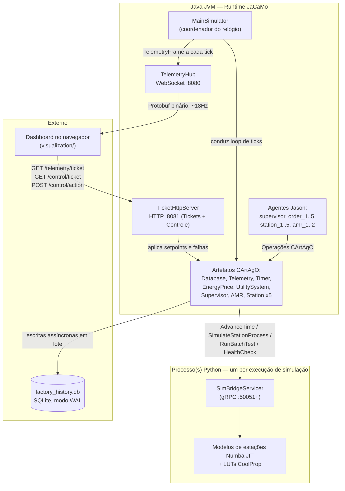

# Matrix Factory Twin — Guia de Integração para Desenvolvedores (Onboarding)

> **Objetivo deste documento.** Um mapa arquitetural prático e guia de engenharia para desenvolvedores que trabalham na base de código do Matrix Factory Twin. A modelagem física/matemática dentro das cinco estações de manufatura é abordada separadamente em `docs/physical-engine/`. Este guia foca na arquitetura de software: agentes, runtimes, protocolos, sincronização e o relógio de simulação por eventos discretos.

---

## 1. O que este projeto realmente é

O **Matrix Factory Twin** é um gêmeo digital (*digital twin*) de eventos discretos de uma linha de manufatura de células a combustível de hidrogênio (PEMFC). Dois ambientes de execução (*runtimes*) cooperam via gRPC:

- Um **sistema multiagente em Java** (JaCaMo: agentes BDI Jason + artefatos de ambiente compartilhado CArtAgO + especificações organizacionais Moise) que modela a camada *cognitiva/logística* — despacho de ordens, negociação de estações, transporte por AMRs e duas filosofias concorrentes de controle de manufatura (PROSA vs. ADACOR), entre as quais o sistema pode alternar dinamicamente em tempo de execução.
- Um **motor físico em Python** (modelos numéricos compilados via Numba JIT, propriedades de gases reais CoolProp, uma extensão em Cython) que modela a camada *física* — cinco estações de manufatura culminando em uma bancada de testes de pilha PEMFC.

Os dois são interligados por um **relógio determinístico em sincronia passo a passo (*lock-stepped*)**: nada nesta simulação usa tempo real do sistema (*wall-clock*) ou `Thread.sleep` para controlar seu ritmo. Toda ação de agente que consome tempo simulado registra uma requisição de "quando você precisa acordar a seguir", e um coordenador central (`MainSimulator.java`) avança todo o sistema — Java e Python juntos — até a requisição mais próxima no tempo. Compreenda esse mecanismo (§5) antes de modificar código de agentes ou de simulação.

Um painel (*dashboard*) no navegador (`visualization/`) assina a telemetria binária via WebSocket e pode injetar *setpoints* de estações e falhas em AMRs em tempo real via HTTP.

Esta base de código também fundamenta um artigo acadêmico de pesquisa: `report.tex`, `docs/artifact-evaluation/` e `docs/citation.md` existem para apoiar a replicação e avaliação de experimentos.

---

## 2. Glossário

| Termo | Significado nesta base de código |
|---|---|
| **JaCaMo** | O framework Java que integra Jason, CArtAgO e Moise (`org.jacamo:jacamo`). |
| **Jason** | A linguagem/runtime de agentes BDI (*Belief-Desire-Intention*). Os planos dos agentes ficam em arquivos `.asl` (`src/agt/`). |
| **CArtAgO** | O modelo de ambiente baseado em artefatos — objetos compartilhados e com estado que os agentes observam e invocam (classes Java que estendem `cartago.Artifact` em `src/main/java/factory/`). |
| **Moise** | A camada de modelo organizacional: papéis (*roles*), grupos e links de autoridade, definidos em `src/org/*.xml`. |
| **BDI** | Crença-Desejo-Intenção (*Belief-Desire-Intention*) — o paradigma de raciocínio no qual agentes possuem crenças (fatos), perseguem objetivos (`!goal`) e reagem a eventos (`+belief`). |
| **Holon** | Uma entidade de manufatura autônoma porém cooperativa (ex.: holon de ordem/pedido, holon de recurso). |
| **PROSA** | Arquitetura Produto-Recurso-Ordem-Staff (*Product-Resource-Order-Staff Architecture*) — negociação heterárquica/plana entre pares (§9). |
| **ADACOR** | Arquitetura de Controle Holônico Adaptativo (*Adaptive Holonic Control Architecture*) — controle hierárquico direcionado por supervisor (§9). |
| **CNP** | Protocolo *Contract-Net* (*Contract-Net Protocol*) — o processo de leilão/licitação que os holons de ordem usam para alocar trabalho aos holons de recurso (§7). |
| **2PC** | *Two-Phase Commit* (Confirmação em Duas Fases) — o protocolo usado para alternar PROSA ⇄ ADACOR sem perder trabalhos em andamento (§9). |
| **NER / TMC** | *Next-Event-Request* / *Time-Managed-Component* — mecanismo de coordenação do relógio de eventos discretos (§5). |
| **PEMFC** | Célula a Combustível de Membrana de Troca de Prótons (*Proton-Exchange-Membrane Fuel Cell*) — o produto fabricado ao longo das 5 estações. |
| **MEA / GDL / ECSA** | Conjunto Membrana-Eletrodo (*Membrane-Electrode Assembly*) / Camada de Difusão de Gás (*Gas-Diffusion Layer*) / Área Superficial Eletroquimicamente Ativa (*Electrochemically-Active Surface Area*) — métricas físicas de qualidade transmitidas entre as estações pelo protocolo de rede. |

---

## 3. Mapa do repositório

```
Matrix_Factory/
├── src/
│   ├── agt/                     Comportamento dos agentes Jason (.asl) — camada cognitiva
│   │   ├── supervisor_agent.asl     Coordenador central, 2PC, monitoramento de defeitos
│   │   ├── order_holon.asl          Representa um lote de produção; executa CNP como iniciador
│   │   ├── resource_holon.asl       Representa uma estação (S1–S5); executa CNP como respondedor
│   │   └── amr_agent.asl            Wrapper cognitivo fino em torno do transporte AMRArtifact
│   ├── org/                     Especificações organizacionais Moise (papéis + links de autoridade)
│   │   ├── prosa_org.xml            Topologia plana de negociação entre pares
│   │   └── adacor_org.xml           Hierarquia de autoridade com supervisor
│   ├── main/java/factory/       Artefatos CArtAgO + infraestrutura de simulação (§6, §12–14)
│   ├── main/proto/sim_bridge.proto  Contrato canônico gRPC/wire (§12)
│   ├── main/resources/          Configuração logback, CSVs de séries temporais de preços de energia
│   └── test/java/factory/       Suíte de testes de integração JUnit e replay determinístico (§16)
├── physical_engine/             Motor de física em Python
│   ├── sim_bridge_server.py         Servidor gRPC implementando RPCs do SimBridge
│   ├── daemon_launcher.py           Inicializa/fixa em núcleos/supervisiona N daemons para execuções em lote
│   ├── proto_index.py               Espelho em Python de ProtoIndex.java (§12)
│   ├── core/                        Tipos base compartilhados (Component, enums, constantes)
│   ├── factory_simulation/          Implementações físicas das cinco estações e suítes pytest
│   ├── optimization/                Aceleração Numba/Cython + cache LUT
│   ├── protos/                      Cópia proto em Python + stubs pb2 gerados
│   └── scripts/                     Pré-construção de LUTs, utilitários de calibração
├── scripts/                     Ferramental operacional (§15)
│   ├── check_proto_sync.py          Valida se todas as cópias de .proto permanecem idênticas
│   ├── generate_certs.sh            Geração de certificados CA/servidor/cliente autoassinados para mTLS
│   ├── generate_factory_jcm.py      Gera arquivos mega-JCM da Fase 4 mesclados com namespaces
│   ├── render_factory_jcm.py        Renderiza factory.jcm para execução única a partir do template
│   └── launch_phase4.sh             Orquestra execuções completas de lote da Fase 4 de ponta a ponta
├── experiments/                 Driver Monte Carlo PROSA vs. ADACOR + análise estatística
├── analysis/                    Resultados de experimentos (CSVs, notebooks, relatórios)
├── visualization/               Dashboard independente em Vanilla-JS + Canvas
├── docs/                        Site completo de documentação mkdocs-material
├── factory.jcm / template       Definição de projeto JaCaMo para execuções únicas de simulação
├── build.gradle, settings.gradle Build Java (Gradle 8.7+, toolchain Java 17)
├── requirements.txt, setup.py   Dependências Python + compilação de extensão Cython
└── run_manual.sh                Atalho automatizado de inicialização da JVM com verificação de build
```

---

## 4. Arquitetura de alto nível



### Princípios Arquiteturais Fundamentais:

1. **Uma JVM Java, um ou múltiplos processos Python.** Uma sessão de desenvolvimento de execução única consiste em uma JVM + um daemon Python (`sim_bridge_server.py --port 50051`). Um lote Monte Carlo da "Fase 4" continua sendo **uma única JVM**, mas coordena até 30 *processos* daemon Python separados (um por execução, cada um em sua própria porta e com núcleos de CPU fixados) com agentes separados por namespaces dentro da JVM.
2. **O loop de ticks conduz tudo.** `MainSimulator.tickLoop()` (`src/main/java/factory/MainSimulator.java`) roda em sua própria thread daemon. Agentes, artefatos, a física em Python e a telemetria são todos sincronizados por esse loop.

---

## 5. O relógio: tempo determinístico em sincronia passo a passo

A simulação nunca utiliza atrasos baseados no relógio do sistema (*wall-clock*):

- Qualquer operação de artefato que consuma tempo simulado (por exemplo, uma estação processando uma ordem ou `TimerArtifact.startTimer`) invoca `MainSimulator.submitNER(agentId, requestedNextTime, optionalLatch)`. Isso registra uma exigência no `nerRegistry` de que o relógio deve avançar até `requestedNextTime`.
- `MainSimulator.tickLoop()` opera em cada tick da seguinte maneira:
  1. Aguarda que os agentes esperados enviem seus NERs para o tick (quórum em modo de melhor esforço).
  2. Calcula `dt = min(todos os requestedNextTime) − currentTime`, limitado a `[MIN_DT=0.01s, MAX_DT=1.0s]`.
  3. Invoca `AdvanceTime(currentTime, dt, schemaEpoch)` do Python via gRPC — o estado físico contínuo é avançado aqui.
  4. Avança `currentTime`, avalia as entradas de `TimerArtifact` cujo `fireAtSimTime <= currentTime` (disparando eventos `timer_expired` no Jason), atualiza propriedades observáveis (preço da energia, posições dos AMRs, status das utilidades) e transmite um `TelemetryFrame`.
  5. Libera os agentes cujo tempo solicitado foi alcançado (`issueTimeAdvanceGrant`), desbloqueando suas threads chamadoras nas operações do CArtAgO.

```mermaid
sequenceDiagram
    autonumber
    participant RH as Holon de Recurso (Jason)
    participant BSA as BaseStationArtifact
    participant MS as MainSimulator (loop de ticks)
    participant PY as SimBridgeServicer (Python)

    RH->>BSA: processOrder(orderId)
    BSA->>PY: SimulateStationProcess(...)
    PY-->>BSA: proc_time_s, defeito, métricas de qualidade
    BSA->>MS: submitNER(agentId, currentTime + proc_time_s)
    BSA->>BSA: await(latch) — bloqueia a thread de operação do agente
    loop a cada tick
        MS->>PY: AdvanceTime(currentTime, dt, epoch)
        PY-->>MS: StepReady(target_time, state_vector)
        MS->>MS: currentTime = target_time; avalia timers; transmite telemetria
        MS->>MS: libera entradas de NER satisfeitas
    end
    MS-->>BSA: contagem do latch zerada quando currentTime >= tempo solicitado
    BSA-->>RH: resultado (ok / defeito)
```

`TimerArtifact.startTimer()` é construído exatamente sobre essa primitiva — ele agenda o temporizador e invoca `submitNER`. Quando um temporizador é cancelado, `cancelTimer()` invoca `removeNER()` para limpar o registro.

> [!IMPORTANT]
> Sempre direcione qualquer lógica de "espera" através de `startTimer` ou `submitNER`. Nunca utilize `Thread.sleep` ou loops de consulta ativa (*polling*) em tempo real.

---

## 6. A camada cognitiva: agentes, artefatos e especificações organizacionais

### 6.1 Relação de agentes (`factory.jcm.template`)

| Agente(s) | Arquivo `.asl` | Papel |
|---|---|---|
| `supervisor` (×1) | `supervisor_agent.asl` | Coordenador central: alternância de regime 2PC, monitoramento de defeitos, prevenção de deadlocks. |
| `order_1` … `order_5` | `order_holon.asl` | Representa lotes de produção ativos; inicia CNP, solicita transporte de AMR, monitora o progresso da receita. |
| `station_1` … `station_5` | `resource_holon.asl` | Representa as estações físicas (S1–S4 = manufatura, S5 = bancada de testes); responde a ofertas de CNP, executa processos de estação. |
| `amr_1`, `amr_2` | `amr_agent.asl` | Wrapper cognitivo para tarefas de transporte por AMR. A lógica de busca de caminhos reside em `AMRArtifact.java`. |

**Pipeline de Manufatura:** As ordens seguem uma receita sequencial de 5 etapas:
1. Estação 1: Prensagem a Quente do MEA (*MEA Hot Pressing*)
2. Estação 2: Revestimento por Slot-Die de Catalisador (*Catalyst Slot-Die Coating*)
3. Estação 3: Estampagem de Placas Bipolares (*Bipolar Plate Stamping*)
4. Estação 4: Montagem e Fixação da Pilha (*Stack Assembly & Clamping*)
5. Estação 5: Bancada de Testes de Polarização PEMFC (*PEMFC Polarization Test Bench*)

### 6.2 Artefatos CArtAgO (`src/main/java/factory/`)

| Artefato | Suporta | Principais responsabilidades |
|---|---|---|
| `BaseStationArtifact` | Estações 1–4 | Máquina de estados de reivindicação/bloqueio/processamento de ordens; invoca `SimulateStationProcess`; gerencia setpoints. |
| `TestBenchArtifact` | Estação 5 | Executa o RPC de streaming `RunBatchTest` e avalia os perfis acumulados de qualidade das etapas anteriores. |
| `AMRArtifact` | AMRs | Busca de caminhos por Space-Time A*, reserva atômica de transporte, modelo de falhas MTBF, utilização do grid. |
| `SupervisorArtifact` | Supervisor | Registro de bloqueios (`OrderId → (station, order)`), controle de 2PC `initiateTransition`/`commitTransition`. |
| `TimerArtifact` | Todos os agentes | Gerenciamento de temporizadores em tempo simulado integrado com `MainSimulator.submitNER`. |
| `EnergyPriceArtifact` | Supervisor, Ordens | Analisa CSVs de séries de preços; sinaliza picos de preço/transições normais com histerese. |
| `UtilitySystemArtifact` | Todos os agentes | Publica estados de armazenamento de H₂, resfriador (*chiller*) e compressor juntamente com `schema_epoch`. |
| `DatabaseArtifact` | Todos os agentes | Persistência SQLite assíncrona e acúmulo em memória do perfil de qualidade para a Estação 5. |
| `TelemetryArtifact` / `TelemetryHub` | Clientes externos | Formata e transmite mensagens `TelemetryFrame` via WebSocket (~18Hz). |
| `TicketHttpServer` / `TicketIssuer` | Clientes externos | Autenticação por tickets HMAC-SHA256 e endpoints de controle HTTP na porta 8081. |

### 6.3 Especificações organizacionais Moise (PROSA vs. ADACOR)

- **`prosa_org.xml`**: Topologia heterárquica. Os agentes negociam diretamente como pares via CNP sem links de autoridade com o supervisor.
- **`adacor_org.xml`**: Topologia hierárquica. Introduz links explícitos de autoridade do supervisor sobre os holons de recursos e ordens para forçar o escalonamento durante sobrecarga do grid ou picos de preço de energia.

---

## 7. Alocação de tarefas via Contract-Net

Fluxo de mensagens para uma etapa de produção (`order_holon.asl` ⇄ `resource_holon.asl`):

```mermaid
sequenceDiagram
    autonumber
    participant OH as Holon de Ordem
    participant RH1 as Holon de Recurso (ex.: station_1)
    OH->>OH: temporizador batch_wait (2s)
    OH->>RH1: achieve call_for_proposal(step, [stations...], orderId)
    Note over OH: Janela de coleta de propostas CNP de 3s
    RH1->>RH1: claimStation() [bloqueio provisório]
    RH1-->>OH: propose(Me, cost)
    OH->>OH: escolhe proponente de menor custo
    OH->>RH1: accept_proposal(orderId) / reject_proposal para os demais
    RH1->>RH1: registerLock(); aguarda item_arrived
    OH->>RH1: reserveTransport & deliver → item_arrived
    RH1-->>OH: inform_start
    RH1->>RH1: processOrder() → RPC SimulateStationProcess
    RH1->>RH1: submitNER(agentId, simTime + tProc) + await(latch)
    RH1-->>OH: step_complete(orderId, step)
    RH1->>RH1: releaseLock(); releaseStation()
    OH->>OH: avança recipe_remaining; inicia próxima etapa ou finaliza
```

### Regras Essenciais de Implementação de Agentes:

1. **Retrate crenças antes de reafirmá-las:** No Jason, uma mensagem `tell` com parâmetros idênticos a uma crença existente não disparará um evento `+belief`. Sempre retrate (`-`) a crença no início da execução do plano, inclusive nas ramificações de *fallback* e tratamento de erro.
2. **Operações de despacho atômicas:** A alocação de recursos compartilhados (por exemplo, reserva de AMR) deve ser realizada em uma única operação CArtAgO (`AMRArtifact.reserveTransport()`), em vez de mensagens de múltiplos passos de consulta e posterior reivindicação pelo agente, evitando condições de corrida (*race conditions*).

---

## 8. Frota de AMRs e logística

`AMRArtifact.java` gerencia o despacho e movimentação dos robôs móveis autônomos (AMRs):

- **Space-Time A\*** (*Cooperative A*\*): Busca de caminhos com tabelas de ocupação 3D `reservedBy[x][y][t]` e `edgeReservations` para evitar colisões e travamentos por troca de arestas (*edge-swapping deadlocks*).
- **Despacho Atômico:** `reserveTransport(fromStation, toStation, orderId)` seleciona o melhor AMR e bloqueia a tarefa em uma única operação.
- **Confiabilidade e Falhas:** Suporta modelagem de falhas por MTBF via `AMR_MTBF_SECONDS` e injeção de falhas em tempo real via endpoint HTTP `/control/action`. A duração do reparo segue `30 + U(0,1) * 90` segundos.
- **Gerenciamento de Bloqueios (*Deadlocks*):** Monitora a ocupação da grade (`getGridUtilization()`), acionando o estrangulamento (*throttling*) pelo supervisor quando a utilização ultrapassa 0,85 e retomando quando cai abaixo de 0,60.

---

## 9. Alternância de regime PROSA ⇄ ADACOR (2PC)

- **Gatilho:** `EnergyPriceArtifact` sinaliza um pico de preço quando os preços *spot* ultrapassam **150 EUR/MWh** (retornando ao normal quando caem abaixo de **135 EUR/MWh**).
- **Execução:** O supervisor executa um *Two-Phase Commit* (2PC) para realizar a transição dos regimes de controle:
  1. **Reserva:** `SupervisorArtifact.initiateTransition()` incrementa e reserva o próximo `schemaEpoch`.
  2. **Fase 0 (Esvaziamento / Drain, TTL de 15s):** `prepare_drain` é transmitido; propostas de CNP ativas são concluídas ou descartadas.
  3. **Fase 1 (Suspensão / Suspend, TTL de 10s):** `suspend_intentions` suspende a execução dos agentes e alinha os estados dos artefatos para ocioso (*idle*).
  4. **Confirmação (Commit):** `MainSimulator.commitTransition()` aplica a nova época e o novo esquema organizacional, publicando a atualização através do `UtilitySystemArtifact`.

A seleção de regime é configurada dinamicamente pela variável de ambiente `ADACOR_ENABLED` (mapeada para `MainSimulator.adacorEnabled`).

---

## 10. Acoplamento de qualidade de manufatura

As métricas de qualidade cascateiam ao longo do pipeline de 5 etapas:

- Conforme uma ordem passa pelas Estações 1–4, `BaseStationArtifact.processOrder()` registra sinalizadores de defeito, variações no tempo de processamento e sinais físicos (taxa de ECSA, índice de dano, pressão de fixação, porosidade da GDL) no `DatabaseArtifact`.
- As métricas são acumuladas **em memória** em caches Caffeine limitados (TTL de 30 minutos) para que o perfil de qualidade completo esteja instantaneamente disponível quando a pilha chegar à Estação 5.
- `TestBenchArtifact` consulta o perfil acumulado (`peekQualityProfile`, `peekMechanisticSignal`) e traduz defeitos e variações em penalidades físicas de degradação na requisição gRPC `RunBatchTest`. Pilhas com defeitos em etapas anteriores apresentam desempenho reduzido nas varreduras de polarização.

---

## 11. O motor físico (lado Python)

`physical_engine/sim_bridge_server.py` implementa o serviço `SimBridge`:

- Mantém um vetor compartilhado de estado termodinâmico de 9 elementos (`ThermoStateIndex`, espelhado de `ProtoIndex.java`), `StackThermalModel`, `TankArray`, `CompressorStage` e `LUTManager` (tabelas de gases CoolProp em cache em `.physical_engine/lut_cache/`).
- `AdvanceTime` é sincronizado por meio de um mutex global (`_physics_step_lock`) para avançar a física da simulação contínua de forma determinística.
- `RunBatchTest` executa as varreduras de polarização em paralelo utilizando o `prange` do Numba.
- `SimulateStationProcess` encaminha para os módulos de física específicos de cada estação (`station1_mea_preparation.py` … `station4_stack_clamping.py`).
- Suporta TLS mútuo via `GRPC_SECURE_MODE=true`.

---

## 12. Referência de comunicação e protocolos

### gRPC — Serviço `SimBridge` (`src/main/proto/sim_bridge.proto`)

| RPC | Direção | Finalidade |
|---|---|---|
| `AdvanceTime` | Java → Python (a cada tick) | Barreira do relógio de eventos discretos (§5); retorna o vetor de estado físico atualizado. |
| `SimulateStationProcess` | Java → Python (por ordem, S1–S4) | Calcula a duração do processamento, ocorrência de defeitos e sinais de qualidade. |
| `RunBatchTest` | Java → Python (por pilha, S5) | Teste de curva de polarização em streaming na bancada de testes. |
| `HealthCheck` | Java → Python (inicialização) | Verifica o aquecimento (*warmup*) do JIT e das LUTs do Python antes do início da simulação. |

> [!NOTE]
> As definições de Protobuf são espelhadas entre `src/main/proto/sim_bridge.proto`, `physical_engine/protos/sim_bridge.proto` e `visualization/sim_bridge.proto`. Execute `python3 scripts/check_proto_sync.py` para verificar a consistência.

### Telemetria via WebSocket

- Transmissão de `TelemetryFrame` em Protobuf binário a ~18Hz em `ws://127.0.0.1:8080/telemetry`.
- Autenticado durante o *handshake* usando tickets de uso único HMAC-SHA256 obtidos via `GET http://127.0.0.1:8081/telemetry/ticket?run_id=N`.

### API HTTP de controle

Hospedada por `TicketHttpServer` na porta 8081:
- `GET /telemetry/ticket?run_id=N`: Emite um ticket de telemetria.
- `GET /control/ticket?run_id=N`: Emite um ticket de ação de controle.
- `POST /control/action`: Aplica atualizações de setpoint nas estações e injeções de falha em AMRs.

---

## 13. Persistência

SQLite (`factory_history.db`) em modo WAL com escrita em lote assíncrona não bloqueante:
- `DatabaseArtifact` enfileira as gravações em três instâncias de `ArrayBlockingQueue` (`Orders`, `StationQuality`, `EnergyTelemetry`, capacidade de 300.000 cada).
- Uma thread escritora em segundo plano descarrega lotes de até 2.000 linhas a cada 500ms usando `executeBatch()`.

---

## 14. Segurança

- **gRPC mTLS:** Configurado com `GRPC_SECURE_MODE=true` utilizando certificados gerados via `scripts/generate_certs.sh`.
- **Tickets HMAC-SHA256:** Gerados por `TicketIssuer.java` no formato `base64(payload).base64(hmac)`. Validados para escopo correto (`telemetry` vs. `control`) e validade de uso único (TTL de 10 segundos).
- **Proteção de Produção (*Production Guard*):** `MainSimulator` encerra a inicialização com falha (*fail-closed*) se `MATRIX_FACTORY_ENV=production` estiver definido sem que ambos `GRPC_SECURE_MODE=true` e `TELEMETRY_REQUIRE_TICKET=true` estejam habilitados.

---

## 15. Executando localmente

**Pré-requisitos:** JDK 17+, Python 3.11+, Gradle 8.7+ (ou `./gradlew`).

```bash
git clone https://github.com/utczbr/Matrix_Factory.git && cd Matrix_Factory
cp .env.example .env
python3 -m venv .venv && source .venv/bin/activate
pip install -r requirements.txt
./gradlew build
```

**Execução interativa única:**
```bash
# Terminal 1: Daemon de Física em Python
.venv/bin/python3 -m physical_engine.sim_bridge_server --port=50051 --run-id=0

# Terminal 2: Sistema Multiagente em Java
./gradlew run --args="0 50051 --max-ticks=1000"
```

**Dashboard em tempo real:**
```bash
python3 -m http.server 8000
# Abra http://127.0.0.1:8000/visualization/ no navegador
```

**Lote Monte Carlo da Fase 4 (até 30 execuções paralelas, uma única JVM):**
```bash
RUN_COUNT=30 BASE_PORT=50051 bash scripts/launch_phase4.sh
```

---

## 16. Testes

**Testes de física em Python (pytest):**
```bash
pytest physical_engine/ -v --cov=physical_engine
```

**Testes do MAS Java e de integração (JUnit 5):**
```bash
./gradlew test
```

- Os testes de integração utilizam `SimulationTestHarness` (`src/test/java/factory/`) para inicializar o `MainSimulator` no mesmo processo com acesso programático ao estado dos artefatos em execução.
- `SeededReplaySeedNTest` verifica a reprodutibilidade bit a bit da simulação para cada semente (*seed*).
- Flags de *test-hook* via CLI para reprodução de falhas:

| Flag | Finalidade |
|---|---|
| `--force-abort-on=<station> --order=<id>` | Injeta aborto no meio da operação |
| `--cnp-slow-accept` | Atrasa a aceitação de proposta do CNP |
| `--ttl=<ms>` | Sobrescreve o TTL de oferta do holon de recurso |
| `--force-spike-at=<simTime>` | Força um pico no preço da energia |
| `--grid-stress` | Simula utilização da grade de AMRs em 0,95 |
| `--block-ack-from=<agent>` | Descarta confirmação de suspensão (*suspend-ack*) no 2PC |
| `--inject-epoch-mismatch-on=<agent>` | Dispara condição de corrida no `schema-epoch` |
| `--disable-adacor` | Força linha de base apenas com PROSA |

---

## 17. Documentação e artefatos de pesquisa

- **`docs/`**: Site de documentação MkDocs abrangendo a modelagem física detalhada, referências de API e guias de arquitetura.
- **`report.tex` / `docs/artifact-evaluation/`**: Código-fonte do artigo acadêmico e matrizes de verificação de alegações (*claim-verification*) para reprodutibilidade.
- **`experiments/` & `analysis/`**: Automação de experimentos de Monte Carlo e notebooks de análise estatística.

---

## 18. Convenções de engenharia e boas práticas

- **Retrate antes de reafirmar:** Qualquer manipulador de `tell` no Jason para uma mensagem que possa se repetir deve retratar (`-`) a crença como sua primeira ação em todas as ramificações de execução.
- **Agrupe leitura e confirmação em operações CArtAgO atômicas:** A alocação de recursos compartilhados deve ocorrer em um único método sincronizado no artefato.
- **Direcione todo avanço de tempo através de `startTimer` e `submitNER`:** Nunca utilize atrasos baseados em tempo real ou pausas de thread (*thread sleep*).
- **Use flags de runtime em vez de alterações em arquivos:** Configure variações experimentais por meio de variáveis de ambiente e propriedades dos artefatos.
- **Defina caminhos explícitos de recuperação de timeout:** Todo estado de espera deve ter um temporizador de vigilância (*watchdog*) e um caminho de limpeza correspondentes.

---

## 19. Para onde ir a partir daqui

- Consulte `docs/getting-started/architecture-overview.md` para diagramas de sistema estendidos.
- Para formulações de modelagem física e química, veja `docs/physical-engine/overview.md`.
- Inspecione os arquivos de planos dos agentes (`src/agt/`) e as implementações dos artefatos (`src/main/java/factory/`) ao estender o comportamento cognitivo e logístico.
