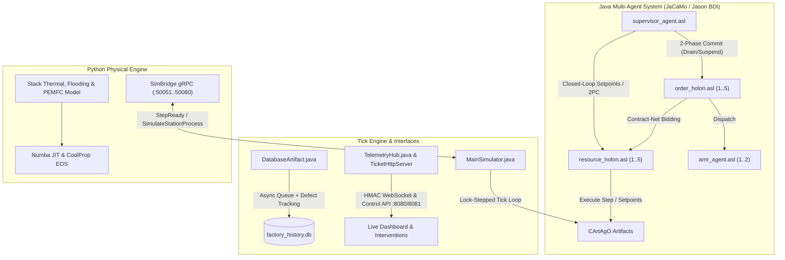

# Matrix Factory Twin

> [!WARNING]
> **RESULTS UNDER AUDIT**: Empirical results, statistical claims, and physical model parameters in this repository are currently under formal review. See [VERIFICATION.md](need-to-fix/VERIFICATION.md) for the findings ledger and remediation roadmap.

[](https://github.com/utczbr/Matrix_Factory/actions)
[](https://www.python.org/)
[](https://www.oracle.com/java/)
[](LICENSE)
[](#visual-architecture--system-flow)

**An event-driven, hybrid multi-agent digital twin framework for modular hydrogen fuel-cell manufacturing, coupling BDI agent cognitive reasoning in Java with first-principles electrochemical physics in Python via a lock-stepped gRPC simulation bridge.**

---

## Visual Architecture & System Flow



---

## Key Features

* **Hybrid BDI & First-Principles Physics**: Combines Jason/CArtAgO agent cognitive reasoning in Java 17 with Numba-accelerated PEMFC fuel cell electrochemistry, dynamic Springer membrane hydration ($\tau_{\text{sorption}}=12\text{s}, \tau_{\text{desorption}}=45\text{s}$), real-gas fugacity EOS (CoolProp LUT), two-phase cathode liquid water flooding ($s_{\text{cap}}=0.35$), $N$-cell 1D stack thermal discretization (`StackThermalModelND`), and cathode air BOP dynamics in Python.
* **Upstream Manufacturing Process Models (Stations 1–4)**: Includes first-principles physical JIT kernels for Station 1 (Kamal–Sourour resin cure kinetics), Station 2 (slot-die catalyst coating hydrodynamics & ECSA spatial ratio), Station 3 (316L bipolar plate stamping with Archard tool wear & Cockcroft-Latham $D_{\text{NCL}}$ damage), and Station 4 (VDI 2230 stack assembly bolt torque friction & clamping pressure).
* **Direct Mechanistic RPC & Closed-Loop Actuation**: Executes Station 1–4 physical kernels per order via the `SimulateStationProcess` gRPC RPC. Supervisor agents dynamically monitor defect drift (`getRecentDefectRate`) and issue closed-loop setpoint adjustments (`adjustSetpoint`).
* **Manufacturing-to-Performance Multiphysics Coupling**: Connects upstream manufacturing signals ($P_{\text{clamp}}$, $\varepsilon_{\text{gdl}}$, ECSA ratio) directly into downstream Station 5 fuel cell polarization sweeps via Bruggeman effective medium conductivity, liquid-water concentration overpotential derating ($D_{\text{eff}}$), and interfacial contact resistance ($R_{\text{contact},0} = 4.20\text{ m}\Omega\cdot\text{cm}^2$).
* **Stochastic AMR Breakdown Model & Deterministic Seeding**: Simulates constant hazard rate MTBF breakdown events and repair downtimes, driven by independent `SplittableRandom` per-AMR seeds. Dispatch logic is fully breakdown-aware (`isFree`).
* **Dynamic Control Schema Transitions**: Real-time Two-Phase Commit (Phase 0 Drain, Phase 1 Suspend) switching between PROSA (peer-negotiated) and ADACOR (hierarchical) upon energy price spikes.
* **Deterministic Lock-Stepped Simulator (TMC)**: Replaces non-deterministic wall-clock sleeps (`Thread.sleep`) with a synchronous Next Event Request (NER) engine in `MainSimulator.java`.
* **Single-JVM Fan-Out Monte Carlo Scale**: Orchestrates up to 30 parallel, fully isolated simulation runs inside a single JVM instance via source-level agent namespace rewriting.
* **Live Web Telemetry & Fault-Injection Dashboard**: Real-time canvas telemetry visualization streaming at `ws://127.0.0.1:8080` with HMAC-signed ticket authentication (`http://127.0.0.1:8081/telemetry/ticket`) and live fault-injection controls (`/control/ticket` & `/control/action`).

---

## Primary Literature Physical Calibration

All physical parameters in the digital twin are ground-truth calibrated against peer-reviewed primary literature across 5 physical domains:

| Domain | Key Formulations | Primary Literature Citations & DOIs |
| :--- | :--- | :--- |
| **Tool Tribology** | Non-linear Archard wear law ($K_{wear,PVD} = 3.50 \times 10^{-6}\text{ mm}^3/\text{N}\cdot\text{m}$, $K_{wear,Duplex} = 1.47 \times 10^{-10}\text{ mm}^3/\text{N}\cdot\text{m}$, $\gamma = 1.35$) | Fernandes et al. (2017) [`10.1016/j.surfcoat.2017.10.052`], Bitay et al. (2021) [`10.1007/s00170-024-13800-x`] |
| **Foil Formability** | Cockcroft-Latham ductile fracture ($C_{crit,NCL} = 0.35$), Hollomon strain hardening ($K = 1280\text{ MPa}, n = 0.43$) | Modanloo et al. (2018) [`10.1007/s00170-018-2210-y`], Blandford et al. (2007) [`10.2172/918231`] |
| **GDL Mechanics & ICR** | Kleemann non-linear tangent modulus ($E_0 = 2.80\text{ MPa}, K_s = 28.5$), Interfacial contact resistance ($R_{contact,0} = 4.20\text{ m}\Omega\cdot\text{cm}^2$) | Kleemann et al. (2009) [`10.1016/j.jpowsour.2008.09.026`], El-Kharouf, Mason et al. (2012) [`10.1016/j.jpowsour.2012.06.099`] |
| **Electrochemistry & Transport**| Multi-parameter Butler-Volmer kinetics ($E_{act} = 68.5\text{ kJ/mol}$, $j_{0,ref} = 2.50 \times 10^{-8}\text{ A/cm}^2$), Springer dynamic sorption ($\tau=12\text{s}/45\text{s}$) | Neyerlin et al. (2006) [`10.1149/1.2266294`], Gasteiger et al. (2005) [`10.1016/j.apcatb.2004.06.021`] |

---

## Quick Start / Installation

### Prerequisites
Make sure your system meets the following version requirements:
* **Java Development Kit (JDK)** $\ge$ 17.0.0
* **Python** $\ge$ 3.11.0
* **Gradle** $\ge$ 8.7.0 (or use included `./gradlew` wrapper)
* **OpenSSL** (optional, for mTLS certificate generation)

### Setup in Under 2 Minutes

```bash
# 1. Clone the repository
git clone https://github.com/utczbr/Matrix_Factory.git
cd Matrix_Factory

# 2. Set up environment variables
cp .env.example .env

# 3. Create and activate Python virtual environment
python3 -m venv .venv
source .venv/bin/activate
pip install -r requirements.txt

# 4. Build Java multi-agent components
./gradlew build
```

---

## Usage & Code Examples

### 1. Running a Single Interactive Simulation
Start the Python physical daemon, then launch the Java MAS engine:

```bash
# Terminal 1: Launch Python physical engine daemon on port 50051
.venv/bin/python3 -m physical_engine.sim_bridge_server --port=50051 --run-id=0

# Terminal 2: Launch Java Multi-Agent System (1000 ticks)
./gradlew run --args="0 50051 --max-ticks=1000"
```

### 2. Running a Monte Carlo Experiment (PROSA vs. ADACOR)
Execute a multi-replication Monte Carlo experiment comparing the PROSA baseline against ADACOR dynamic schema switching under energy price disturbances:

```bash
# Runs PROSA + ADACOR simulations and outputs analysis/results.csv
python3 experiments/run_prosa_vs_adacor.py
```

### 3. Statistical Analysis & Report Generation
Compute 95% bootstrap confidence intervals, Shapiro-Wilk normality tests, and Mann-Whitney U significance metrics from experiment results:

```bash
python3 experiments/analyze_results.py analysis/results.csv
```

### 4. Running in Secure Mode (TLS / mTLS)
Enable production-grade Mutual TLS authentication between Java artifacts and Python daemons:

```bash
# 1. Generate local 2048-bit RSA certificates
bash scripts/generate_certs.sh certs/

# 2. Start Python server in secure mode
GRPC_SECURE_MODE=true .venv/bin/python3 -m physical_engine.sim_bridge_server --port=50051 --run-id=0

# 3. Start Java MAS in secure mode
GRPC_SECURE_MODE=true ./gradlew run --args="0 50051 --max-ticks=1000"
```

### 5. Launching the Live Telemetry Web Dashboard & Interventions Panel

Start the local HTTP server to view real-time AMR movements, station states, thermal heatmaps, and live fault-injection controls:

```bash
# 1. Start Python HTTP server in workspace root
python3 -m http.server 8000

# 2. Open http://127.0.0.1:8000/visualization/ in your browser
```

### 6. Running Test Suites & Calibration Reports

```bash
# Run Python physical engine test suite (71 pytest unit, property & integration tests)
.venv/bin/pytest physical_engine/

# Run Stations 1–4 Monte Carlo process calibration report (10,000 runs)
PYTHONPATH=. .venv/bin/python3 physical_engine/scripts/calibrate_stamping_clamping.py

# Run Java MAS integration test suite (18 isolated JVM test classes)
./gradlew test
```

---

## Tech Stack & Prerequisites

| Layer | Technologies & Frameworks | Minimum Version | Purpose |
| :--- | :--- | :--- | :--- |
| **Multi-Agent System (MAS)** | Java, JaCaMo (Jason BDI, CArtAgO, MoISE), Gradle | Java 17+, Gradle 8.7+ | BDI agent reasoning, organizational roles, closed-loop setpoint control, and Contract-Net negotiations. |
| **Physical Engine** | Python, gRPC / Protobuf, Numba, NumPy, SciPy, CoolProp | Python 3.11+ | First-principles PEMFC electrochemistry, dynamic sorption, liquid flooding, N-cell thermal discretization, and JIT sweeps. |
| **Security & Interfaces** | OpenSSL TLS/mTLS, Tyrus WebSocket, HMAC SHA-256 | OpenSSL 1.1+ | Encrypted gRPC daemon channels, authenticated browser telemetry, and scoped control ticket authorization. |
| **Persistence** | SQLite JDBC (WAL mode), `ArrayBlockingQueue` | SQLite 3+ | Thread-safe, lock-free historic event, defect rate, energy telemetry, and process variation logging. |
| **Analysis & Reporting** | Pandas, SciPy (`shapiro`, `mannwhitneyu`), LaTeX | Python 3.11+ | Statistical hypothesis testing, confidence interval extraction, and manuscript builds. |

---

## Contributing & License

Contributions are welcome! Please feel free to open Issues or submit Pull Requests for bug fixes, physical model expansions, and algorithmic improvements.

### License
This project is open-source software licensed under the **[MIT License](LICENSE)**.
