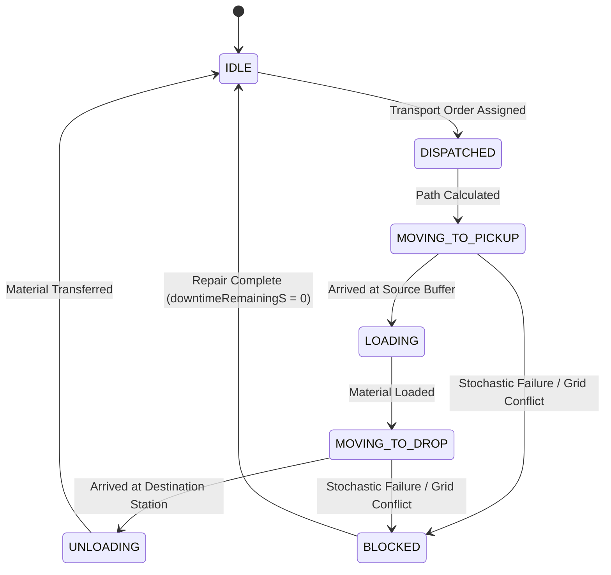

# AMR Fleet Agents & Logistics (Reference)

This document describes the role, state transitions, stochastic failure model, and deterministic seeding of `amr_agent.asl` and `AMRArtifact.java`.

---

## Agent Role & Transport Logistics

AMR Fleet Agents handle intralogistics transport of in-process MEAs, bipolar plate stacks, and finished fuel cell units between buffer storage racks and station processing cells (Stations 1 $\rightarrow$ 5).

---

## State Machine & Failure Dynamics

---

## Stochastic Failure Model & Deterministic Seeding

`AMRArtifact.java` includes a constant hazard rate MTBF failure model ($P_{\text{fail}} = \frac{\Delta t}{\text{MTBF}}$) driven by independent per-AMR `SplittableRandom` streams:

- **RNG Seeding**: `fleetRng = new SplittableRandom(("amr-fleet-" + runId).hashCode() ^ runId)` ensures bit-for-bit reproducible breakdown sequences per run seed.
- **Downtime Countdown**: When an AMR experiences a failure, status switches to `AMR_BLOCKED` and `downtimeRemainingS` is set to repair ETA ($30\text{s} + \text{sample} \times 90\text{s}$).
- **Dispatch Awareness**: `isFree(a)` checks `a.downtimeRemainingS <= 0`, preventing orders from being assigned to broken-down AMRs.

---

## Live Fault-Injection & Telemetry

- **Manual Trigger**: The dashboard or HTTP control API can issue `/control/action` with `type: "amr_breakdown"`, invoking `AMRArtifact.triggerBreakdown(amrId, downtimeSeconds)`.
- **Telemetry State**: `AMRSnapshot` streams `breakdownActive` (`a.downtimeRemainingS > 0`) over WebSocket telemetry frames.

---

## Code Reference

* Agent Source File: [`src/agt/amr_agent.asl`](file:///home/stuart/Documentos/matrix_factory_twin/src/agt/amr_agent.asl)
* Java Artifact: [`src/main/java/factory/AMRArtifact.java`](file:///home/stuart/Documentos/matrix_factory_twin/src/main/java/factory/AMRArtifact.java)
* Telemetry Snapshot Record: [`src/main/java/factory/AMRSnapshot.java`](file:///home/stuart/Documentos/matrix_factory_twin/src/main/java/factory/AMRSnapshot.java)
