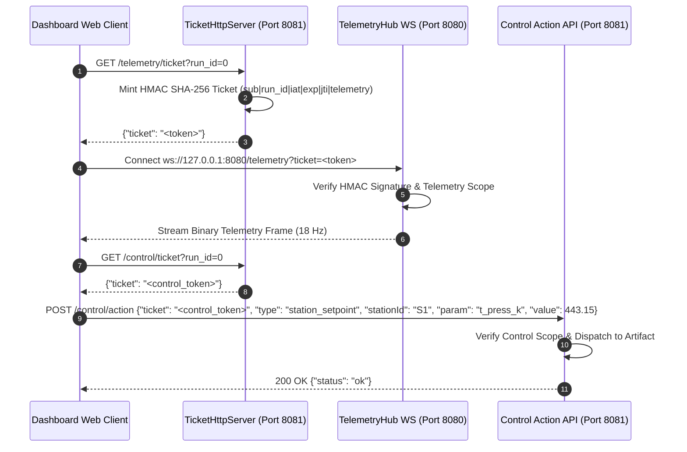

# WebSocket TelemetryHub & Control API Specifications (Reference)

This document describes the real-time telemetry streaming service (`TelemetryHub.java`), WebSocket endpoints, JSON/Protobuf payload structures, HMAC SHA-256 client authentication flows, and live fault-injection HTTP APIs.

---

## Authentication Ticket Flow & Scoped Claims

To connect to the live WebSocket telemetry stream (`ws://127.0.0.1:8080/telemetry`) or issue live fault-injection actions, dashboard clients request scoped ticket tokens from the HTTP ticket server on port 8081:

- **Telemetry Scope**: `http://127.0.0.1:8081/telemetry/ticket?run_id=N` -> Token with `scope="telemetry"`.
- **Control Scope**: `http://127.0.0.1:8081/control/ticket?run_id=N` -> Token with `scope="control"`.



---

## WebSocket Binary Telemetry Payload Schema

Telemetry is streamed as **binary Protobuf** frames (`TelemetryFrame`, defined in `sim_bridge.proto`) at a target rate of ~18 Hz (`TelemetryArtifact.PUBLISH_INTERVAL_S = 1.0 / 18.0`). Each binary frame contains:

```protobuf
message AMRState {
  string amr_id              = 1;
  int32  grid_x              = 2;
  int32  grid_y              = 3;
  int32  next_grid_x         = 4;
  int32  next_grid_y         = 5;
  float  movement_progress   = 6;
  AMRStatusEnum status       = 7;
  string carrying_order_id   = 8;
  bool   amr_breakdown_active = 9;  // Live stochastic/manual breakdown state
}

message TelemetryFrame {
  uint64 sequence_number             = 1;
  double sim_time_s                  = 2;
  int32  schema_epoch                = 3;
  string active_org_schema           = 4;

  repeated AMRState     amr_states     = 5;
  repeated StationState station_states = 6;
  repeated double thermo_state_vector  = 7 [packed = true];

  double station5_stack_voltage_v       = 8;
  double station5_current_density_a_cm2 = 9;
  double station5_stack_temp_k          = 10;
  double station5_stack_core_temp_k     = 11;
  double station5_stack_skin_temp_k     = 12;
  uint32 station5_failure_flags         = 13;
  bool   station5_has_run_test          = 21;
  bool   station5_last_test_passed      = 22;
  string station5_last_tested_stack_id  = 23;
  repeated double station5_last_measured_voltages = 24 [packed = true];

  double h2_tank_pressure_bar           = 14;
  double h2_tank_fill_fraction          = 15;
  double chiller_temp_k                 = 16;
  double compressor_power_kw            = 17;

  uint32 dropped_telemetry_frame_count  = 18;
  uint32 dropped_ner_count              = 19;
  uint32 run_id                         = 20;
}
```

---

## Live Fault-Injection & Control HTTP API

The control endpoint `/control/action` enables authenticated live setpoint adjustments and fault injection:

1. **Station Setpoint Adjustment**:
   - `{"ticket": "...", "type": "station_setpoint", "stationId": "S1", "param": "t_press_k", "value": 443.15}`
   - Dispatches to `BaseStationArtifact.adjustSetpoint(param, value)`.
2. **AMR Breakdown Injection**:
   - `{"ticket": "...", "type": "amr_breakdown", "amrId": "AMR-1", "downtimeSeconds": 60.0}`
   - Dispatches to `AMRArtifact.triggerBreakdown(amrId, downtimeSeconds)`.

---

## Code Reference

* Ticket Issuer & Scope Verifier: [`src/main/java/factory/TicketIssuer.java`](file:///home/stuart/Documentos/matrix_factory_twin/src/main/java/factory/TicketIssuer.java)
* Ticket HTTP Server: [`src/main/java/factory/TicketHttpServer.java`](file:///home/stuart/Documentos/matrix_factory_twin/src/main/java/factory/TicketHttpServer.java)
* Telemetry Hub: [`src/main/java/factory/TelemetryHub.java`](file:///home/stuart/Documentos/matrix_factory_twin/src/main/java/factory/TelemetryHub.java)
* Dashboard Frontend Client: [`visualization/dashboard.js`](file:///home/stuart/Documentos/matrix_factory_twin/visualization/dashboard.js)
