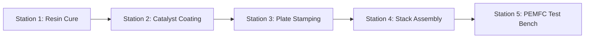

# Physical Engine Overview & Numba Bridge

This document describes the high-performance physical simulation engine underpinning **Matrix Factory Twin**, detailing its Numba JIT compilation strategy, CoolProp equation-of-state coupling, gRPC communication layer, and multi-station physical fidelity models.

---

## Technical Stack & Acceleration Strategy

The physical engine is implemented in Python 3.11 with Numba JIT acceleration:

* **Numba JIT Compilation (`@njit`):** Converts Python numerical ODE/PDE solvers into machine code:
    * ~10–100× for general JIT-compiled loops vs. pure Python (`_numba_ops_core_python.py`).
    * ~10–50× for `numba.prange`-parallelized interpolation kernels.
    * ~50–200× specifically for replacing runtime CoolProp calls with the pre-computed LUT layer (`optimization/lut_manager.py`).

* **CoolProp Integration:** Provides thermodynamic fluid property lookups via a bilinear-interpolated Lookup Table (LUT) layer (`optimization/lut_manager.py`) caching seven species: `H2, O2, N2, CO2, CH4, CO, H2O`.

* **gRPC SimBridge IPC Interface:** High-speed binary IPC channel using Protocol Buffers over TLS (`AdvanceTime`, `SimulateStationProcess`, `RunBatchTest`, `HealthCheck`).

---

## Station Model Overview

| Station | Primary Physical Domain | Key Mathematical Models | Accelerated Module |
| --- | --- | --- | --- |
| **Station 1: Resin Cure** | Chemical Kinetics & Thermal | Kamal–Sourour autocatalytic curing, Arrhenius rate constants (`t_press_k`, `dwell_time_s`) | `station1_mea_preparation.py` |
| **Station 2: Coating** | Fluid Hydrodynamics | Slot-die coating deviation model, ECSA ratio calculation (`v_coat_m_s`, `mu_slurry_pa_s`) | `station2_catalyst_deposition.py` |
| **Station 3: Stamping** | Continuum Mechanics & Damage | Archard tool wear, Cockcroft–Latham ductile damage ($D_{\text{NCL}}$) (`press_force_kn`, `die_stroke_count`) | `station3_bipolar_plate_stamping.py` |
| **Station 4: Assembly** | Solid Mechanics & Contact | VDI 2230 bolt torque friction, GDL compression & Bruggeman porosity derating (`applied_torques_nm`, `friction_coefficients`) | `station4_stack_clamping.py` |
| **Station 5: PEMFC Test** | Electrochemistry & Transport | Nernst potential, Butler–Volmer ORR kinetics, dynamic Springer sorption hysteresis, cathode liquid saturation flooding, N-cell thermal discretization | `pemfc_model.py`, `membrane_hydration.py`, `stack_thermal_model.py` |

---

## Closed-Loop Actuation & Physical Inter-Station Coupling

Physical output states from upstream stations serve as boundary constraints for downstream processes and fuel cell performance sweeps:

1. **Station 1–4 Direct Mechanistic RPC (`SimulateStationProcess`)**:
   - Executes real JIT station kernels from Java `BaseStationArtifact` per order.
   - Closed-loop agent control adjusts setpoints (`adjustSetpoint`) dynamically based on recent defect rate tracking (`getRecentDefectRate`).

2. **Dynamic Sorption Hysteresis (`membrane_hydration.py`)**:
   - First-order relaxation dynamics: $\tau_{\text{sorption}}=12\text{s}$ (uptake), $\tau_{\text{desorption}}=45\text{s}$ (release).
   - $\lambda(t)$ evolves dynamically during continuous simulation instead of assuming instantaneous equilibrium.

3. **Two-Phase Liquid Water Transport & Flooding (`pemfc_model.py`)**:
   - Cathode GDL liquid water saturation $s \in [0.0, 0.99]$ with capacity $s_{\text{cap}} = 0.35$.
   - Bruggeman gas diffusivity correction $D_{\text{eff}} = D_0 \varepsilon (1-s)^{1.5}$ dynamically derates limiting current $j_{\text{lim}}$.

4. **N-Cell Thermal Discretization (`stack_thermal_model.py`)**:
   - `StackThermalModelND` models a 1D chain of $N$ thermal nodes along the coolant flow path with Yonkist criterion validity checking.
